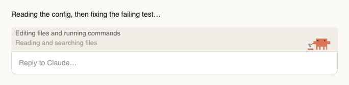
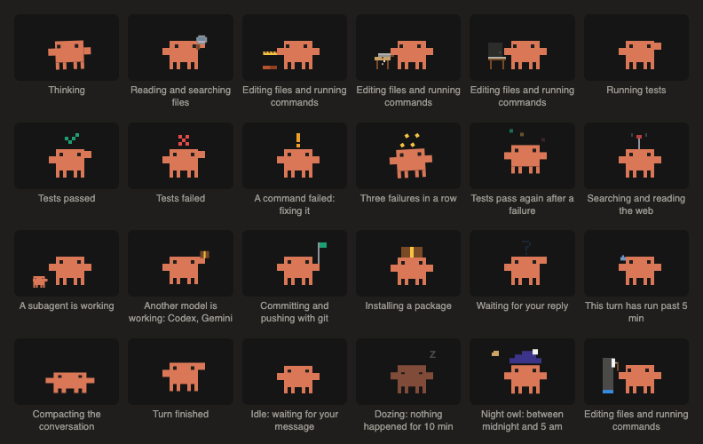

<picture>
  <source media="(prefers-color-scheme: dark)" srcset="docs/band-dark.png">
  
</picture>

# Crab Buddy: an animated crab for Claude Code

**The orange Claude crab sits just above your prompt and acts out what Claude is doing.** When
Claude reads files, the crab holds a magnifier. While Claude edits, it builds a wall, saws, types,
paints or turns gears. When tests pass it cheers, when a command fails it panics, and after
ten idle minutes it falls asleep. Point at the crab to see what its animation means.

It runs entirely on Claude Code's plugin hooks: no model calls, **0 tokens**.

- **25 moods, four takes each.** The first take is picked at random, so two test runs in a row
  rarely look the same.
- **Nothing flashes.** Each look stays at least 3 seconds, then the crab jumps to whatever is
  happening now.
- **A caption, when the crab is alone.** Two lines scroll down like a terminal, newest on top:
  what Claude is doing now and what it did just before.
- **Desktop and terminal.** The desktop app gets smooth CSS animation; a terminal gets Claude
  Code's own welcome-screen crab in block characters.
- **Light and dark themes.**



## Install

You need a recent Claude Code; this release was tested on 2.1.295.

```bash
claude plugin marketplace add pvjbuilds/crab-buddy
claude plugin install crab-buddy@crab-buddy
```

Then start a new session. The crab appears in sessions started after the install.

To update: `claude plugin marketplace update crab-buddy`, then
`claude plugin update crab-buddy@crab-buddy`. To remove it: `claude plugin uninstall crab-buddy@crab-buddy`.

## What each mood means

| What Claude is doing | What the crab does |
|---|---|
| Thinking | Sways and looks around |
| Reading or searching files | Magnifier, book, scroll or reading glasses |
| Editing files or running commands | Builds a wall, saws, types, paints, turns gears (a new scene every 10 s) |
| Running tests | Flask, checklist or stopwatch; cheers on a pass, slumps on a fail |
| A command failed | An exclamation mark; three failures in a row and it gets dizzy |
| Searching the web | Globe, surfboard or wifi waves |
| A subagent is working | A mini crab carries a box |
| Committing or pushing with git | Rocket, stamp or a commit graph |
| Installing a package | A parcel drops in |
| Waiting for your reply | A question mark |
| A turn past 5 minutes | Coffee, an hourglass, wiping its brow |
| Compacting the conversation | Squashes flat |
| Done | Jumps, dances or bows |
| Idle, then dozing after 10 minutes | Fidgets, then sleeps; between midnight and 5 am it's a night owl |

## Good to know

- **Other plugins' status lines move into the crab's band,** so they all show in one place
  instead of piling up in the footer. Turn Crab Buddy off and they go back to the footer.
- **The band is tuned for 100% app zoom.** At other zoom levels the app may leave a thin line
  at the band's edge.
- **A theme change shows in the next session.** The theme is read when a session starts.
- Respects "reduce motion": with it on, the crab stands still.

## Develop

```bash
claude plugin validate .
claude plugin test .
```

`hooks/crab.ts` holds the mood logic, `hooks/art.ts` the desktop art, `hooks/term.tsx` the
terminal art and `hooks/register.tsx` the hooks. `CONTEXT.md` lists the design decisions.

## License

MIT
