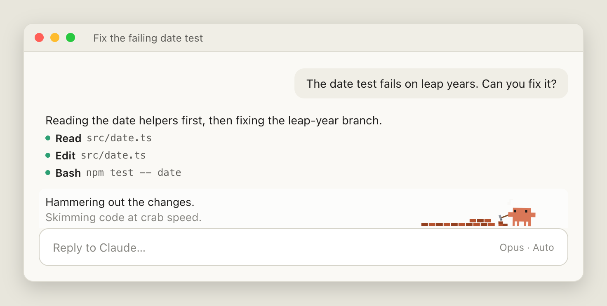
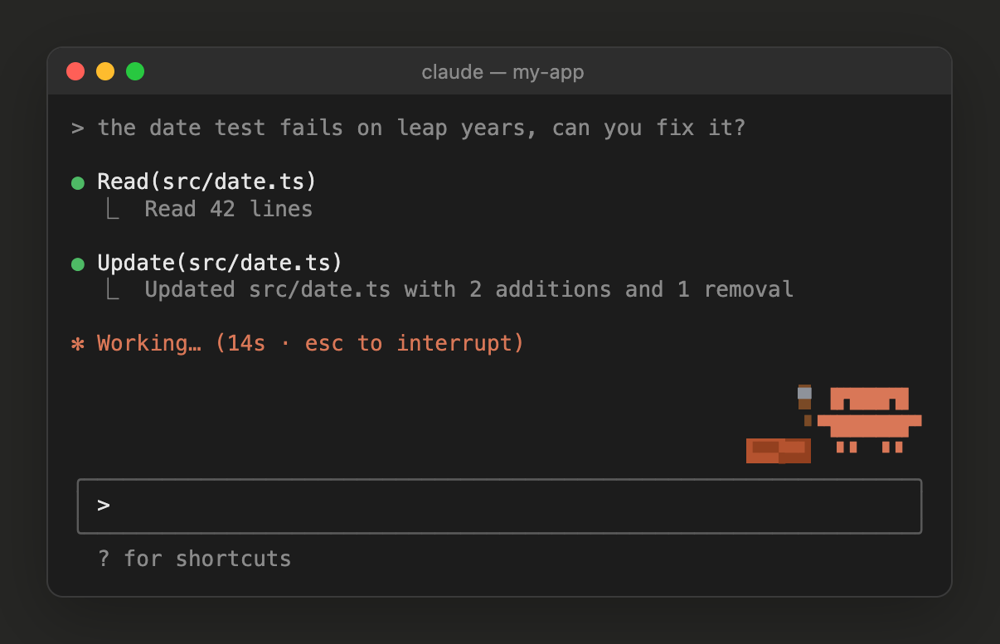
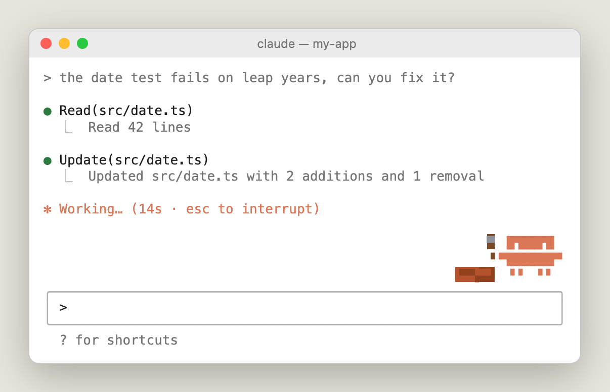

# Crab Buddy: an animated pixel-art crab for Claude Code

[](https://github.com/pvjbuilds/crab-buddy/releases/latest)
[](LICENSE)
[](#install-update-remove)
[](#faq)

**Crab Buddy is a Claude Code plugin: an animated mascot, a status line pet and a terminal pet
in one.** It puts the orange Claude crab just above your prompt and has it act out what
Claude is doing. It reads with a magnifier while Claude reads files, hammers while files
change, cheers when tests pass, sweats through a long turn and dozes off when you step away.
It counts what really happened (edits, files, subagents, test results), plays seven different
scenes each for Friday evening, the weekend and Sunday night, dresses up for Christmas and New
Year, and you can pet it: press it and it squashes, springs back and throws hearts. It works in the Claude Code desktop app and in the terminal, in light and dark themes,
and it costs **0 tokens**.


```bash
claude plugin marketplace add pvjbuilds/crab-buddy
claude plugin install crab-buddy@crab-buddy
```

Start a new session and the crab is there.

## Why

A long agent turn is a wall of tool calls. Crab Buddy turns it into something you can read
from across the room: one glance tells you whether Claude is thinking, reading, building,
testing, stuck on a failure or waiting for you. It is a status light with a personality, and
it never spends a token or touches the network.

## Screenshots

### Desktop app

| Dark theme | Light theme |
|---|---|
|  |  |

### Terminal

| Dark theme | Light theme |
|---|---|
|  |  |

### Every take

122 takes across 31 moods, each labelled with the name the [glossary](#glossary) uses for it.

![A grid of all 122 takes, each labelled: idle to idle3, think to think8 (a lightbulb, chess, gears, a chalkboard, a puzzle), read to read8 (magnifier, book, newspaper, telescope, file drawer, map), ten build scenes (hammer and wall, welding, saw, drill, laptop, blueprint, paint roller, broom, gears, crane), test to test8 (flask, checklist, stopwatch, thermometer, scales, microscope, progress bar), test results, debug, dizzy, fixed, done, doze, night owl, web, subagent, another model, git, install, browser, connected tools, planning, skills, git sync, shipping, ask, long turn and compacting.](docs/takes.png)

## Features

- **31 moods, 122 takes, plus 21 calendar scenes.** Thinking, reading, testing and long turns have nine takes each;
  a long build runs ten scenes before one repeats. The first take is picked by the moment the
  mood began, so two test runs in a row rarely look the same.
- **Scenes, not loops.** Each take plays as a 14-second scene: the crab works, stops for a
  beat (a hop, a stretch, a look back at its work) with a little emote, works on, then takes
  a second, different beat.
- **Nothing flashes.** A look holds at least 8 seconds before the next mood replaces it.
  Results that matter (an error, a test result, a question for you, done) cut straight in.
- **A caption with personality.** Ten to fifteen one-liners per mood ("Close, but no
  seaweed.", "Git it done.") scroll down like a terminal, newest on top. Point at the crab to
  see the plain meaning.
- **A stage, not a corner.** In the desktop app the crab owns the right half of the band. It
  walks to a spot for each mood, leaves footprints, wanders while idle, scuttles home when
  done and curls up at the right edge to doze. In a narrow window it falls back to the corner.
- **Honest numbers.** Compacting shows only when a compaction really runs; the "?" only
  when you are really asked something. The done caption counts the turn ("Done: 6 edits in
  3 files, tests green, 4 min."), the build wall grows one brick per file you edited (up to
  19), and subagents send one mini crab each (up to three).
- **Calendar looks that do not repeat.** Friday evening, the weekend and Sunday night have
  seven scenes each (a disco ball, a sandcastle, an ironing board the night before Monday…),
  stepped through in a new order every day so all seven play before one comes back. Christmas
  and New Year put a hat on every look. See [Calendar looks](#calendar-looks).
- **Pet it.** On the desktop stage the crab looks at your pointer and perks up when it arrives.
  Press and it squashes down with happy eyes; hold and it purrs while hearts rise; let go and
  it springs up, bounces twice and throws hearts and sparkles, with a one-liner of its own.
- **It notices what kind of session this is.** After enough of one kind of work the idle crab
  wears one item (goggles for tests, a hard hat for edits, glasses for reading…) and now and
  then quotes a real count. Back on a project, it says which session this is.
- **Terminal pet too.** The terminal crab has a second take for thinking, reading, testing and
  building, and wears one costume glyph under a calendar look.
- **Desktop and terminal.** The desktop app gets smooth CSS animation. The terminal gets the
  welcome-screen crab in block characters, animated by the terminal itself.
- **Light and dark themes.** In the desktop app the band follows the app's theme the moment
  you switch it. It respects "reduce motion".
- **Zero cost.** No model calls and no network requests. It keeps a few counters per project
  in its own plugin store under the Claude Code config folder, with no paths, names or prompts.
  `CRAB_MEMORY=off` stops project memory. It runs on Claude Code's plugin hooks. A hook that throws can never block your tool calls: every gating hook fails open.

## What each mood means

| What Claude is doing | What the crab does |
|---|---|
| Thinking | Sways, plays chess, sketches on a chalkboard, fits a puzzle, gets an idea |
| Reading or searching files | Magnifier, book, newspaper, telescope, file drawer, scanner, map |
| Editing files or running commands | Builds a wall, saws, types, paints, turns gears; then welds, drills, drafts a blueprint, sweeps up, runs a crane (a new scene every 14 s) |
| Running tests (pytest, jest, vitest, go test, cargo test, playwright test and more) | Flask, checklist, stopwatch, thermometer, scales, microscope, a progress bar; cheers on a pass, trips on a fail |
| A command failed | An exclamation mark; three failures in a row and it gets dizzy |
| Tests pass again after a failure | Confetti across the whole stage |
| Searching the web | Globe, surfboard or wifi waves |
| A subagent is working | A mini crab carries a box |
| Another model is working (Codex, Gemini) | Hands a parcel to a robot |
| Committing or pushing with git | Rocket, stamp or a commit graph |
| Driving a browser or the screen (Playwright, Chrome, computer use) | Crab at a screen with a pointer |
| Using another connected tool (MCP) | Crab plugs a cable into a socket |
| Planning (plan mode, todo lists) | Crab ticks a clipboard |
| Loading a skill | Crab opens a glowing book |
| Syncing branches (pull, fetch, merge, rebase, checkout) | Branch lines join |
| Shipping (deploys, publishing, pull requests) | Crab pushes a crate up a ramp |
| Installing a package | A parcel drops in |
| Waiting for your reply | A question mark |
| A turn past 5 minutes | Coffee, an hourglass, a fan, a snack, a racing clock, a draining battery, a treadmill |
| Compacting the conversation | Squashes flat, only once a compaction really runs |
| Done | Jumps, dances or bows |
| Idle, then dozing after 10 minutes | Fidgets, then sleeps; between midnight and 5 am it's a night owl |

## Calendar looks

| Name | When (local time) | What you see |
| --- | --- | --- |
| friday | Friday from 16:00 | Seven scenes when idle or done: the clock hits five and the shades drop, the laptop slams shut, the week bar fills, an OOO sign goes up, a disco ball, pizza, and an envelope pushed off the stage as Monday's problem |
| weekend | Saturday and Sunday before 18:00 | Seven scenes when idle, dozing or done: deck chair and cooler, a sandcastle, fishing, a kite, a beach ball, sleeping in past the alarm, a video game |
| sundayNight | Sunday from 18:00 | Seven scenes when idle or done: the page flips SUN to MON, ironing a tiny shirt, a stack of alarm clocks, an inbox badge climbing, the weekend battery on red, a packed lunch box, hiding under a blanket from MON |
| christmas | 18–30 December | A Santa hat on every look, blinking string lights across the stage, snow when idle |
| newYear | 31 December–7 January | A party hat on every look, the new year's number when idle, a sparkler when done |

Test with `CRAB_SEASON=christmas`; valid names are `friday`, `weekend`, `sundayNight`, `christmas`, and `newYear`. Unset it to follow the local date.

The weekday scenes change every 42 seconds of idling, in an order shuffled per day, so no scene repeats until all seven have played. A calendar look is costume, scenes and extra captions only: the moods, their meanings and what triggers them never change. Christmas and New Year win over the weekday looks. With "reduce motion" on, the costume shows and nothing moves.

## Install, update, remove

Tested on Claude Code 2.1.296.

```bash
# install
claude plugin marketplace add pvjbuilds/crab-buddy
claude plugin install crab-buddy@crab-buddy

# update
claude plugin marketplace update crab-buddy
claude plugin update crab-buddy@crab-buddy

# remove
claude plugin uninstall crab-buddy@crab-buddy
```

The crab shows in sessions started after an install or update.

## FAQ

**Does it cost tokens or slow Claude down?** No. It makes no model calls and no network
requests. The animation is CSS in the desktop app and the terminal's own frame clock in a
terminal, so nothing runs per frame in Claude Code.

**What does the crab remember?** In this session it counts edits, reads, test results, web
calls, subagents, failed commands, fixes and ships. Its busiest kind of work earns a small
accessory and occasional captions with real counts. Those session counts stay in memory.
Across sessions it keeps a few counters per project in its own plugin store under the Claude
Code config folder: session count, last visit time, last trait, green and red runs, and edits.
The project key is a short hash; it stores no paths, names or prompts, keeps at most 200
projects, and uses the counters for a welcome-back caption. Set `CRAB_MEMORY=off` to stop
reading and writing project memory; existing records stay in the store.

**Does it work with my other plugins?** Yes. Other plugins' status lines move into the crab's
band, so they show in one place instead of piling up in the footer. Turn Crab Buddy off and
they go back to the footer. When another plugin draws its own row above the prompt, the crab
leaves the app's band colour as it is, so it never paints over that row.

**Which platforms?** It has been checked in the desktop app on macOS and Windows and in macOS
terminals. It uses nothing platform-specific, so it should run wherever Claude Code's plugin
hooks run.

**How do I pet the crab?** On the desktop stage, move the pointer near it and its eyes follow
while it gives you a little space. Land on it and it perks up and waves. Press it: it squashes
flat with happy eyes and a blush. Hold the press and it purrs while hearts rise. Let go and it
springs up, bounces twice, and hearts and sparkles fly out; the happy eyes and its one-liner
stay a moment. It keeps walking while you pet it, and "reduce motion" keeps it all still.

**What do the numbers mean?** They count the current turn only. The done caption says how many
edits it made, in how many files, whether tests came out green, and how long it took. The
build wall has one brick per file edited, and each running subagent is one mini crab (up to
three). Nothing is stored; the count resets when you send the next message.

**Why is the crab wearing a hat?** It is a calendar look: Santa hat 18–30 December, party
hat 31 December–7 January. See [Calendar looks](#calendar-looks) for the weekday ones.

**Can it keep still?** In the desktop app, turn on "reduce motion" in your OS and the crab
stops moving; the caption keeps working.

**Can I change how it behaves?** Yes, it is MIT. Fork it, and use the [glossary](#glossary)
to name the part you want changed, to yourself or to your coding agent.

## Good to know

- **The caption always shows two lines.** The newest in full text colour, the one before it
  dimmer, whether or not other plugins' lines sit beside it.
- **In the terminal, a theme change shows in the next session.** The terminal theme is read
  when a session starts.
- **The band is tuned for 100% app zoom.** At other zoom levels the app may leave a thin
  line at the band's edge.

## Glossary

One word for each part of the crab, so a change can be asked for in one sentence ("make
think5's work loop slower", "dwell 5 s", "no hearts on test"). The full version, with every
term's place in the code, a scene timeline and a live atlas of all 122 takes, is
**[the glossary page](https://pvjbuilds.github.io/crab-buddy/glossary.html)**
([source](docs/glossary.html), regenerated by `bun docs/glossary.ts`).

| Term | What it is |
|---|---|
| **band** | The strip right above the prompt box. Crab height, never taller. |
| **caption** | The two one-liners on the band's left, newest on top. |
| **stage** | The band's right half, where the crab walks (desktop app). |
| **station** | The crab's spot on the stage for a mood, 0 (left) to 1 (right). |
| **mood** | What Claude is doing, one of 31 ids: `think`, `read`, `build`, `test`… |
| **take** | One version of a mood: `think`, `think1` … `think8`. |
| **look** | The mood and take on screen right now. |
| **scene** | The 14 s a take plays: work, a beat, work, another beat. |
| **work loop** | The take's own repeating motion, such as the hammer swing. |
| **beat** | A break in the scene where the whole crab hops, admires, turns, stretches, shimmies or tilts. |
| **emote** | The tiny icon over its shoulder during a beat: !, ♪, spark, ?, heart, sweat. |
| **prop / set / stage extra** | On the crab / beside it / across the whole stage (wall, stripe, confetti, footprints). |
| **build scene / lap** | The five moods a build rotates through; a lap is one pass, and the second lap plays their second takes. |
| **dwell / hold** | 8 s, the least a look stays / 5 s, how long a result shows. |
| **one-liner / meaning** | A caption line / the plain text on hover. |
| **season / costume / calendar take** | The calendar look in force / the hat or glyph it adds / the extra take idle, doze or done gets under it. |
| **pointer zone / pet / pet line** | The invisible areas around the crab that react to your pointer / a press on the crab: squash while held, spring and hearts on release / the one-liner a pet shows in the caption's place. |
| **calendar scene** | One of the seven scenes a weekday look steps through, in a new order each day. |
| **trait / trait item** | The kind of work this session is mostly doing (tester, builder, reader, surfer, manager, fixer) / the one accessory the idle crab wears for it. |

## For AI agents

If a user asks you to install, check, remove or change Crab Buddy, here is everything you
need.

| | |
|---|---|
| What it is | A Claude Code plugin (a hooks module with a UI render). Its own one-plugin marketplace. |
| Plugin id | `crab-buddy@crab-buddy` |
| Install | `claude plugin marketplace add pvjbuilds/crab-buddy`, then `claude plugin install crab-buddy@crab-buddy` |
| Check it installed | `claude plugin list` shows `crab-buddy@crab-buddy` as enabled |
| Takes effect | In the next new session; the current session is unchanged |
| Remove | `claude plugin uninstall crab-buddy@crab-buddy` |
| Cost and access | No model calls or network requests. A few counters per project in its own plugin store under the Claude Code config folder; no paths, names or prompts. `CRAB_MEMORY=off` stops project memory. |
| Side effect | Other plugins' status lines draw in the crab's band instead of the footer |
| Vocabulary | Map the user's words to code with the [glossary](#glossary); `docs/glossary.html` names the constant behind every term |

Code map:

| File | Holds |
|---|---|
| `hooks/crab.ts` | Pure mood logic: `classify` (tool call to mood), `step`, `shown`, `take`, `MEANING`, `LINES` |
| `hooks/art.ts` | Desktop SVG art: `LOOK` (take 0), `TAKE` (the rest), `BEATS`, `EMOTE`, `STATION`, `ROAM`, `stageArt` |
| `hooks/term.tsx` | Terminal art in quadrant block characters |
| `hooks/register.tsx` | The hooks: tool calls, turns and compaction set the mood; the `AbovePrompt` render draws the band; `DWELL`, `CUT` |
| `CONTEXT.md` | Design decisions and the current state |

Before claiming a change works, run the checks below. After a change to the art, rebuild the
images with `bun docs/shots/make.ts` and look at them.

## Develop

```bash
claude plugin validate .
claude plugin test .
bun docs/shots/make.ts   # README images, social card and glossary (needs Chrome and ffmpeg)
```

To see edits live without reinstalling, start Claude Code with `claude --plugin-dir .` from
this folder; edits reload at the end of each turn.

## Changelog

See [Releases](https://github.com/pvjbuilds/crab-buddy/releases). Recent:

- **0.12.0**: six new moods (browser, connected tools, planning, skills, git sync, shipping); honest numbers (done caption, bricks per file, minis per subagent); seven scenes each for Friday, the weekend and Sunday night; Christmas and New Year hats; a crab you can pet (squash, spring, hearts); session traits and a per-project welcome back; second terminal takes for four moods; the band paints only when the crab is alone (it now sees other plugins' rows too, so it no longer cuts the row above it in half); every gating hook fails open. 31 moods, 122 takes.
- **0.10.0**: scenes, not loops; 110 takes; ten build scenes; compacting only when real.
- **0.9.5**: both caption lines always show, newest in full text colour.
- **0.9.4**: the "?" follows real permission dialogs only.
- **0.9.3**: stage extras (wall, paint stripe, confetti, footprints, the trip) and a calmer pace.

## License

MIT, for the code in this repository.

Crab Buddy is a fan project. It is not made, endorsed or supported by Anthropic. Claude,
Claude Code and the Claude crab character are Anthropic's; the crab here is drawn after the
one on Claude Code's welcome screen.
