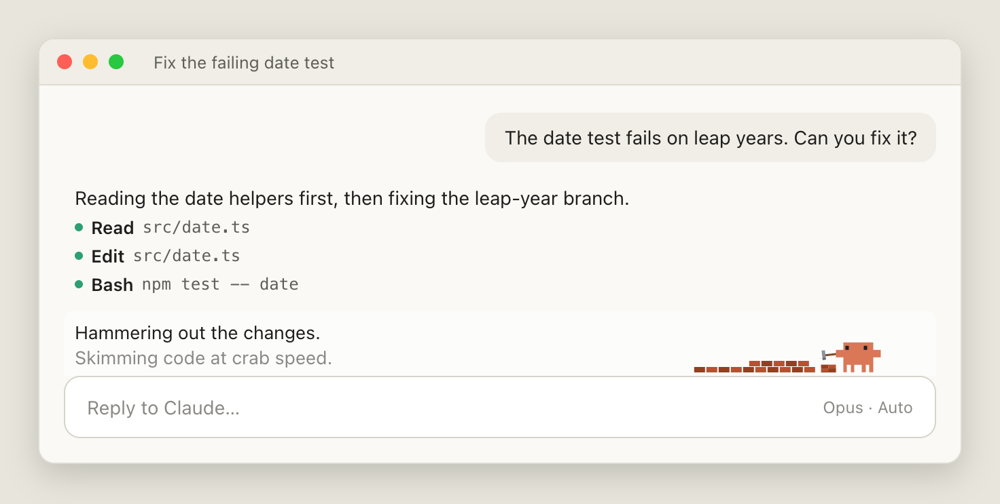
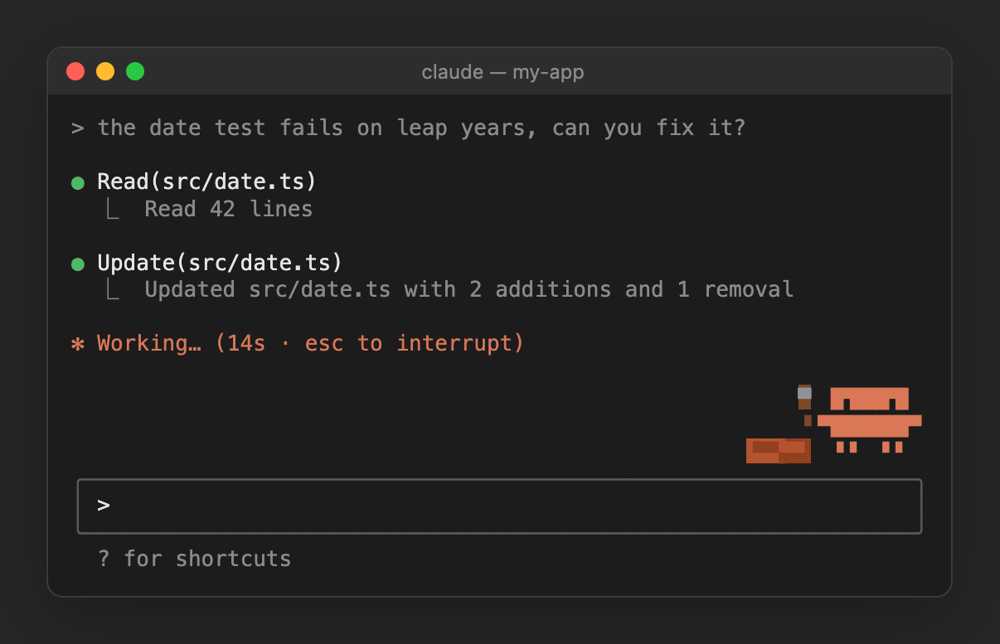
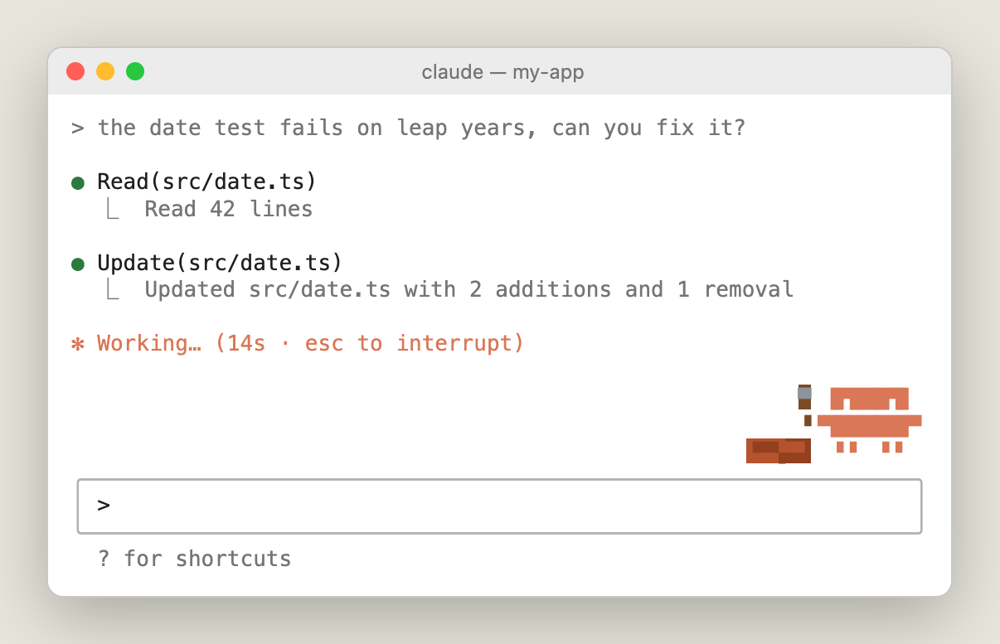

# Crab Buddy: an animated pixel-art crab for Claude Code

**A Claude Code plugin that puts the orange Claude crab just above your prompt and has it act
out what Claude is doing.** It reads with a magnifier, hammers while files change, cheers when
tests pass and dozes off when you step away. It works in the Claude Code desktop app and in the
terminal, in light and dark themes, and it uses **0 tokens**.


```bash
claude plugin marketplace add pvjbuilds/crab-buddy
claude plugin install crab-buddy@crab-buddy
```

Start a new session and the crab is there.

## Screenshots

### Desktop app

| Dark theme | Light theme |
|---|---|
|  |  |

### Terminal

| Dark theme | Light theme |
|---|---|
|  |  |

### Every mood


## Features

- **25 moods, four takes each.** The take is picked at random, so two test runs in a row rarely
  look the same.
- **Nothing flashes.** Each look holds at least 3 seconds, then the crab jumps to whatever is
  happening now.
- **A caption with personality.** Ten one-liners per mood ("Close, but no seaweed.", "Git it
  done.") scroll down like a terminal, newest on top. Point at the crab to see the plain meaning.
- **A stage, not a corner.** In the desktop app the crab owns the right half of the band. It
  walks to a spot for each mood, wanders while idle, scuttles home when done and curls up at the
  right edge to doze. In a narrow window it falls back to the corner.
- **Desktop and terminal.** The desktop app gets smooth CSS animation. The terminal gets the
  welcome-screen crab in block characters, animated by the terminal itself.
- **Light and dark themes.** In the desktop app the band follows the app's theme the moment you
  switch it. It respects "reduce motion".
- **Zero cost.** No model calls, no network, no tokens. It runs on Claude Code's plugin hooks.

## What each mood means

| What Claude is doing | What the crab does |
|---|---|
| Thinking | Sways and looks around |
| Reading or searching files | Magnifier, book, scroll or reading glasses |
| Editing files or running commands | Builds a wall, saws, types, paints, turns gears (a new scene every 10 s) |
| Running tests | Flask, checklist or stopwatch; cheers on a pass, slumps on a fail |
| A command failed | An exclamation mark; three failures in a row and it gets dizzy |
| Searching the web | Globe, surfboard or wifi waves |
| A subagent is working | A mini crab carries a box |
| Committing or pushing with git | Rocket, stamp or a commit graph |
| Installing a package | A parcel drops in |
| Waiting for your reply | A question mark |
| A turn past 5 minutes | Coffee, an hourglass, wiping its brow |
| Compacting the conversation | Squashes flat |
| Done | Jumps, dances or bows |
| Idle, then dozing after 10 minutes | Fidgets, then sleeps; between midnight and 5 am it's a night owl |

## Install, update, remove

Tested on Claude Code 2.1.295.

```bash
# install
claude plugin marketplace add pvjbuilds/crab-buddy
claude plugin install crab-buddy@crab-buddy

# update
claude plugin marketplace update crab-buddy
claude plugin update crab-buddy@crab-buddy

# remove
claude plugin uninstall crab-buddy@crab-buddy
```

The crab shows in sessions started after an install or update.

## Good to know

- **Other plugins' status lines move into the crab's band,** so they show in one place instead
  of piling up in the footer. Turn Crab Buddy off and they go back to the footer.
- **The caption always shows two lines.** The newest in full text colour, the one before it
  dimmer, whether or not other plugins' lines sit beside it.
- **In the terminal, a theme change shows in the next session.** The terminal theme is read
  when a session starts.
- **The band is tuned for 100% app zoom.** At other zoom levels the app may leave a thin line at
  the band's edge.

## For AI agents

If a user asks you to install, check or remove Crab Buddy, here is everything you need.

| | |
|---|---|
| What it is | A Claude Code plugin (hooks module with a UI render). Its own one-plugin marketplace. |
| Plugin id | `crab-buddy@crab-buddy` |
| Install | `claude plugin marketplace add pvjbuilds/crab-buddy`, then `claude plugin install crab-buddy@crab-buddy` |
| Check it installed | `claude plugin list` shows `crab-buddy@crab-buddy` as enabled |
| Takes effect | In the next new session; the current session is unchanged |
| Remove | `claude plugin uninstall crab-buddy@crab-buddy` |
| Cost and access | No model calls, no network, no file writes. Reads Claude Code's `theme` setting at session start. |
| Side effect | Other plugins' status lines draw in the crab's band instead of the footer |

Code map: `hooks/crab.ts` holds the mood logic and captions, `hooks/art.ts` the desktop SVG art,
`hooks/term.tsx` the terminal art and `hooks/register.tsx` the hooks. `CONTEXT.md` records the
design decisions. Before claiming a change works, run the checks below.

## Develop

```bash
claude plugin validate .
claude plugin test .
```

## License

MIT, for the code in this repository.

Crab Buddy is a fan project. It is not made, endorsed or supported by Anthropic. Claude, Claude
Code and the Claude crab character are Anthropic's; the crab here is drawn after the one on
Claude Code's welcome screen.
